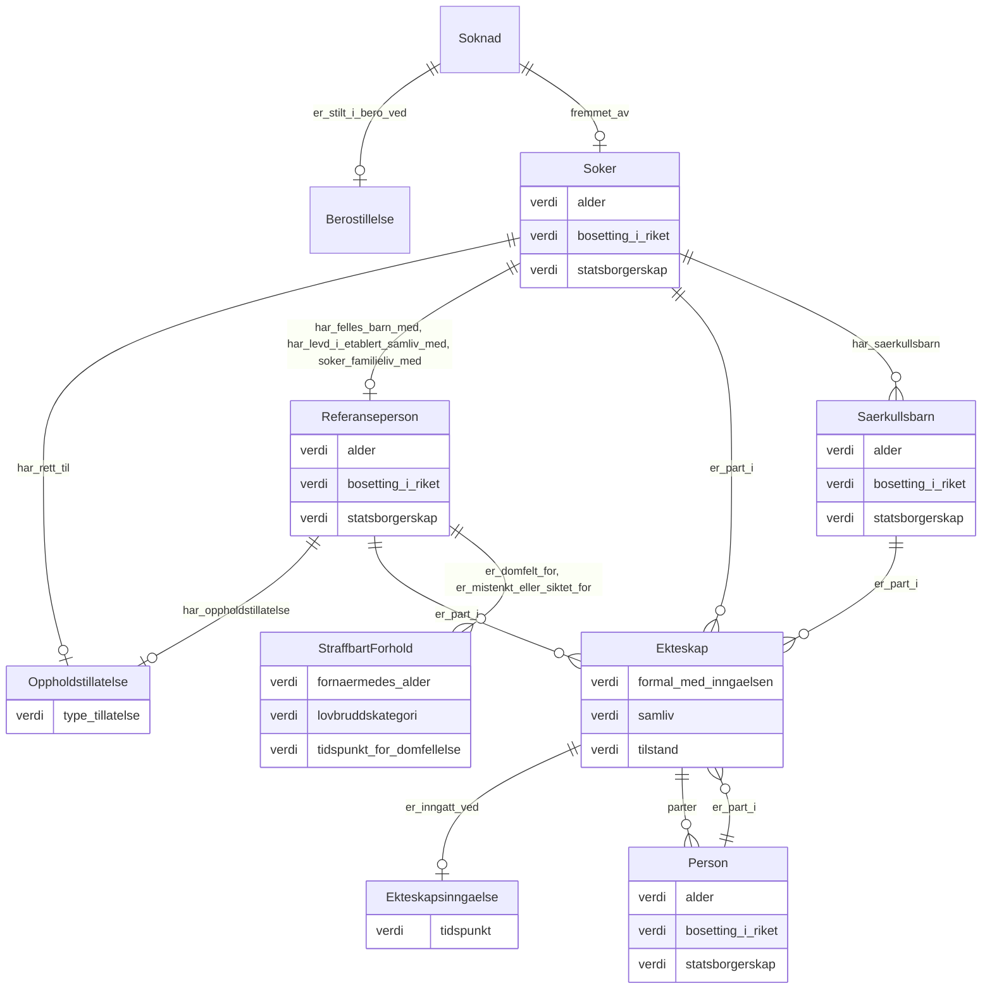

# Prøvekjøring: utlendingsloven § 40 (ektefeller)

Utkast laget maskinelt 16.11.2026 fra Lovdatas åpne data (lov ajourført 14.11.2026). Ingenting er juridisk validert. Formålet er å teste metoden på én bestemmelse før hele kapittel 6 annoteres.

## Hva juristen bes om

1. Gå gjennom `analyse/familieinnvandring/annotering.csv` (51 rader). Sett `status` til `godkjent`, `endret` eller `avvist`, og skriv initialer i `vurdert_av`.
2. Se over den konseptuelle modellen og hjemlene under. Er klasser, egenskaper og relasjoner riktig forstått, og holder hjemlene?
3. Vurder spørsmålene nederst, og de interne funnene i `intern/funn-utl-40.md` (ikke i det åpne repoet).
4. Noter omtrent hvor lang tid gjennomgangen tok.

## Modellen

Modellen har to nivåer. Den konseptuelle modellen gjengir det loven selv nevner, uten datatyper, og hjemlene står der. Den logiske modellen legger til datatyper, ja/nei-felt og kodeverk, og peker til det konseptuelle elementet hvert element realiserer. Juristen trenger bare å vurdere den konseptuelle modellen.

### Konseptuell modell

### Elementer og hjemler

| Element | Type | Materiell hjemmel | Behandlingsgrunnlag | Innhentingshjemmel | Særlig kategori |
| --- | --- | --- | --- | --- | --- |
| Person | klasse | utl-39-1 |  |  |  |
| Søker | klasse | utl-40-1 |  |  |  |
| Referanseperson | klasse | utl-39-1 |  |  |  |
| Særkullsbarn | klasse | utl-40-5 |  |  |  |
| Ekteskap | klasse | utl-40-1 |  |  |  |
| Ekteskapsinngåelse | klasse | utl-40-4 |  |  |  |
| Oppholdstillatelse | klasse | utl-40-1 |  |  |  |
| Søknad om oppholdstillatelse | klasse | utl-40-6 |  |  |  |
| Berostillelse | klasse | utl-40-6 |  |  |  |
| Straffbart forhold | klasse | utl-40-6 |  |  |  |
| alder | egenskap | utl-40-2 | utl-83a-1 | utf-17-7-1-a utf-17-7j-2-e | nei |
| statsborgerskap | egenskap | utl-40-1-a | utl-83a-1 | utf-17-7-1-a utf-17-7j-2-e | nei |
| bosetting i riket | egenskap | utl-40-1-a | utl-83a-1 | utf-17-7j-2-e | nei |
| tilstand | egenskap | utl-40-7 | utl-83a-1 | utf-17-7j-2-e | nei |
| samliv | egenskap | utl-40-3 | utl-83a-1 | utl-83-1 | nei |
| formål med inngåelsen | egenskap | utl-40-4 | utl-83a-1 | utl-83-1 | nei |
| tidspunkt | egenskap | utl-40-4 | utl-83a-1 | utl-83-1 | nei |
| type tillatelse | egenskap | utl-40-1-b utl-40-1-c utl-40-1-d | utl-83a-1 |  | nei |
| lovbruddskategori | egenskap | utl-40-6 | utl-83a-1 | utl-85-2 utf-17-8-1 | straffedommer og lovovertredelser |
| tidspunkt for domfellelse | egenskap | utl-40-6 | utl-83a-1 | utl-85-2 utf-17-8-1 | straffedommer og lovovertredelser |
| fornærmedes alder | egenskap | utl-40-6 | utl-83a-1 | utl-85-2 utf-17-8-1 | straffedommer og lovovertredelser |
| er part i | relasjon | utl-40-1 utl-40-7 | utl-83a-1 | utf-17-7-1-a utf-17-7j-2-e | nei |
| parter | relasjon | utl-40-1 | utl-83a-1 | utf-17-7-1-a utf-17-7j-2-e | nei |
| er inngått ved | relasjon | utl-40-4 | utl-83a-1 | utl-83-1 | nei |
| søker familieliv med | relasjon | utl-39-1 | utl-83a-1 |  | nei |
| har rett til | relasjon | utl-40-1 | utl-83a-1 |  | nei |
| har felles barn med | relasjon | utl-40-5 | utl-83a-1 | utl-83-1 utf-17-7j-2-e | nei |
| har levd i etablert samliv med | relasjon | utl-40-5 | utl-83a-1 | utl-83-1 | nei |
| har særkullsbarn | relasjon | utl-40-5 | utl-83a-1 | utl-83-1 | nei |
| har oppholdstillatelse | relasjon | utl-40-1-b utl-40-1-c utl-40-1-d | utl-83a-1 |  | nei |
| er domfelt for | relasjon | utl-40-6 | utl-83a-1 | utl-85-1 utl-85-2 utf-17-8-1 | straffedommer og lovovertredelser |
| er mistenkt eller siktet for | relasjon | utl-40-6 | utl-83a-1 | utl-85-1 utf-17-8-1 | straffedommer og lovovertredelser |
| fremmet av | relasjon | utl-40-1 | utl-83a-1 |  | nei |
| er stilt i bero ved | relasjon | utl-40-6 | utl-83a-1 |  | nei |

Kilde-ID-ene slås opp i `kilderegister.csv`. `utl-40-1-a` betyr utlendingsloven § 40 første ledd bokstav a.

## Regler (holdes utenfor modellen)

| Regel | Kilde | Type | Beskrivelse | Skjønn |
| --- | --- | --- | --- | --- |
| R-utl-40-01 | utl-40-1 | vilkar | Søkeren er ektefelle til referansepersonen. | nei |
| R-utl-40-02 | utl-40-1-a | vilkar | Referansepersonen er norsk eller nordisk statsborger og er bosatt eller skal bosette seg i riket. | nei |
| R-utl-40-03 | utl-40-1-b | vilkar | Referansepersonen har permanent oppholdstillatelse. | nei |
| R-utl-40-04 | utl-40-1-c | vilkar | Referansepersonen har eller får tillatelse som kan danne grunnlag for permanent oppholdstillatelse. | nei |
| R-utl-40-05 | utl-40-1-d | vilkar | Referansepersonen har tillatelse etter kollektiv beskyttelse, og ordningen har ikke opphørt. | nei |
| R-utl-40-06 | utl-40-2 | avledningsregel | Begge parter er over 18 år. Alder beregnes fra fødselsdato. Unntak for parter som omfattes av 24-årskravet i § 41 a. | nei |
| R-utl-40-07 | utl-40-3 | vilkar | Ektefellene skal bo sammen, med mindre særskilte omstendigheter tilsier noe annet. | ja |
| R-utl-40-08 | utl-40-4 | vilkar | Tillatelse kan nektes når det hovedsakelige formålet med ekteskapsinngåelsen mest sannsynlig var å gi søkeren oppholdsgrunnlag. | ja |
| R-utl-40-09 | utl-40-5 | vilkar | Tillatelse kan nektes når søkeren verken har felles barn eller etablert samliv med referansepersonen, og søkeren eller særkullsbarn mest sannsynlig vil bli mishandlet eller grovt utnyttet. | ja |
| R-utl-40-10 | utl-40-6 | avledningsregel | Tillatelse til særkullsbarn skal som hovedregel nektes når referansepersonen de siste 10 årene er domfelt for seksuallovbrudd mot barn under 18 år. | ja |
| R-utl-40-11 | utl-40-6 | vilkar | Søknaden skal stilles i bero når forelderens ektefelle er mistenkt eller siktet for et straffbart forhold som kan få betydning for søknaden. | nei |
| R-utl-40-12 | utl-40-7 | vilkar | Har referansepersonen inngått ekteskap med flere, kan bare én ektefelle få tillatelse. Tillatelse kan ikke gis når referansepersonen allerede er gift med en person som er bosatt i riket. | nei |
| R-utl-40-13 | utl-40-7 | vilkar | Tillatelse kan nektes når referansepersonen tidligere har vært gift, og de tidligere ektefellene mest sannsynlig akter å fortsette samlivet. | ja |

## Spørsmål til juristen

- **Skjønnsmessige vurderinger:** Formålet med ekteskapsinngåelsen er tatt med som egenskap i den konseptuelle modellen, merket som skjønnsmessig vurdering. Risiko for mishandling og særskilte omstendigheter står bare i regellisten. Hvor skal grensen gå?
- **§ 40 første ledd bokstav d:** Kollektiv beskyttelse er tatt med som tillatelsestype, selv om beskyttelse ellers er utenfor piloten.
- **Term:** Loven beskriver omgåelsesekteskap uten å navngi det. Hvilken term skal brukes?
- **Begreper:** Fem av åtte definisjoner i `begreper/familieinnvandring.yaml` er egne utkast, fordi loven ikke definerer termene.

## Ikke gjort i prøvekjøringen

- Berikelse fra forarbeider, rundskriv og UDI retningslinjer (steg 7).
- Oppslag i eksisterende begrepskataloger (del av steg 5).
- Utlendingsforskriften § 9-1a og § 9-1b, som utfyller § 40, er i kilderegisteret, men ikke annotert.
